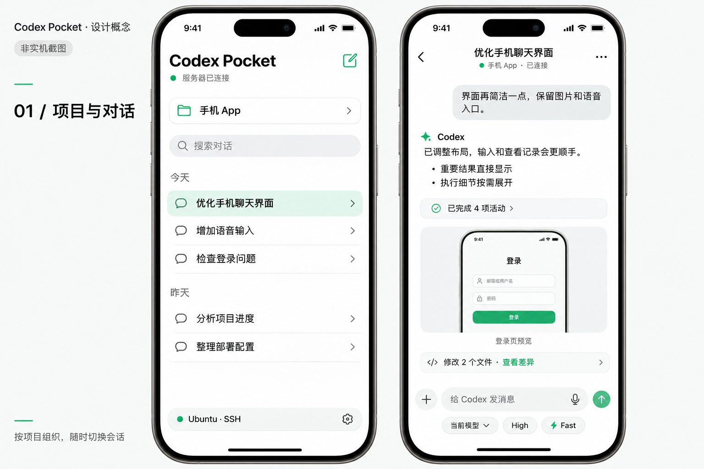
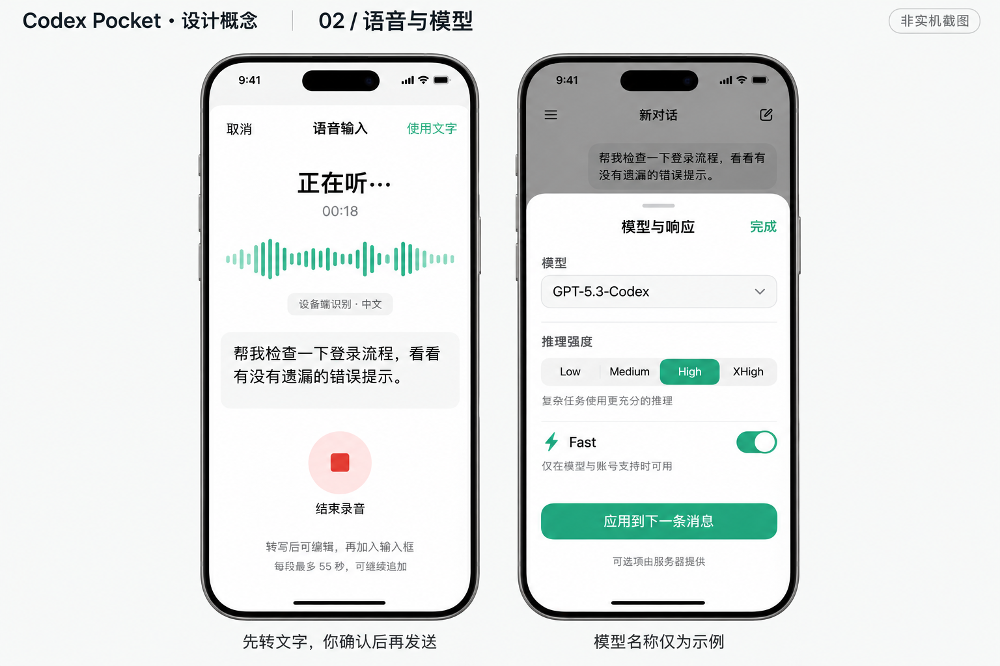
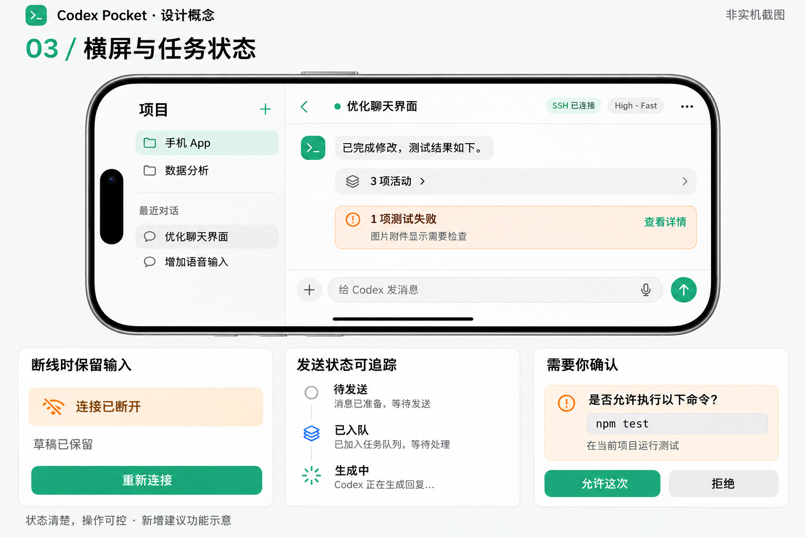

# Codex Pocket 0.3

原生 SwiftUI 手机聊天客户端，通过 SSH 连接 Ubuntu 上的 Codex CLI。主要入口是项目、会话和消息，不需要 ChatGPT 手机端提供远程连接能力。

**状态：本轮功能源码已补齐，服务端测试通过；尚未经过 Xcode 编译、iOS 模拟器或真机验证，也未连接用户服务器。** 它是待验收的开发版本，不是已签名安装包，也不宣称与 macOS Codex 完全等价。

本地接手开发请先阅读 [Mac 开发交接](docs/MAC_HANDOFF.md)。

## 功能

- 按项目工作目录筛选会话，搜索、分页、切换、新建会话。
- 消息气泡、多行输入、上下滚动、加载旧记录、回到最新；向上翻阅时不被实时刷新拉回底部。
- 语音输入：麦克风入口、实时转写和音量波形、停止/取消、编辑/继续追加；确认后加入已有草稿，由用户手动发送。使用 iOS Speech，支持时设备端识别，否则可能使用 Apple 网络服务。
- 普通活动折叠、重要结果和错误保留、显示全部活动；不删除原始记录。
- Markdown 段内样式、链接、代码块横向滚动与复制。
- 历史图片、服务器本地图片、生成图片、相册附件、纯图片消息；全屏拖动缩放。
- 从服务器读取模型、推理强度与服务档位，选择值进入真实 turn/start 请求。Fast 按目录中的真实 ID 发送，没提供就禁用。
- 通过持续的 app-server 连接接收回复增量；手机轮询这个连接的最新状态，活跃轮次约 0.8 秒一次。
- 命令/文件变更确认卡、结构化问答卡、停止当前轮次。
- iPhone 横竖屏、安全区、大屏分栏、动态字体、系统深浅色。
- 不依赖服务器的本地演示模式，方便先验收 UI。

完整规则与参考：[消息展示策略](docs/DISPLAY_POLICY.md)。语音行为与权限：[语音输入](docs/VOICE_INPUT.md)。验证状态与设备边界：[验证记录](docs/VALIDATION.md)。

## 在 Mac 先检查界面

1. 安装 Xcode 16 或更高版本及 iOS 模拟器运行时。
2. 打开 `ios/CodexPocket.xcodeproj`，等待依赖解析（Mac 需能访问 GitHub）。
3. 选择模拟器，Run，点击“先预览聊天界面”。演示模型和回复有明确标识，不会产生真实请求。
4. 测试项目切换、聊天输入、折叠活动、图片预览、问答卡、模型设置和旋转。麦克风功能仍调用实际 iOS 服务，需允许麦克风及语音识别权限；最终应在真机验收。

运行编译及模拟器测试：

```bash
bash scripts/check-mac.sh
```

如装到真机，在 Signing & Capabilities 选择自己的 Apple 团队，必要时改 Bundle Identifier，并开启 iPhone 开发者模式。免费账号的签名有效期按 Xcode 提示处理。

`.xcodeproj` 已生成，不需要 XcodeGen。新增源文件后可运行 `python3 scripts/generate_project.py`。`ios/project.yml` 为可选 XcodeGen 配置。附带的 GitHub workflow 只有手动触发入口，尚未运行 CI。

## Ubuntu 安装（后续联调时再做）

将 `server` 文件夹传到服务器，用**运行 Codex 的同一 Linux 用户**执行：

```bash
cd server
bash install.sh
```

要求已有 `python3`、已登录的 `codex`。tmux 只用于备用的终端辅助功能，不是主聊天入口的前提。

脚本安装到 `~/.local/lib/codex-pocket` 和 `~/.local/bin`，不会修改 SSH 配置或防火墙。手机只连接现有 SSH 端口。服务端持续连接由每个用户私有的 Unix socket 暴露给桥接脚本，不监听公网端口。

App 内填写主机、端口、用户名及**服务器主机公钥**：

```bash
cat /etc/ssh/ssh_host_ed25519_key.pub
```

使用“本机密钥”时，将 App 显示的**登录公钥**追加到该用户的 `~/.ssh/authorized_keys`（目录 700、文件 600），不要覆盖已有文件。也可以用 SSH 密码认证；不支持交互式 MFA。凭据保存到设备钥匙串，不同步 iCloud。

## 正在运行的会话

桥接优先用 `codex app-server proxy` 连接现有的本地共享 daemon；成功时用同一个线程 UUID 调用官方接口，不创建对话副本。

若共享 daemon 不可用，桥接建立独立 app-server：手机新建的会话可完整操作；外部已有会话可读历史、文字排队。**不会自动恢复外部会话形成第二个运行实例。** 这时模型更改、图片、停止和手机确认卡对外部会话禁用，界面说明原因。

是否能在共享连接中接收另一个客户端正在处理的审批，取决于 Codex 版本及请求路由。没有收到或不支持的请求仍需原客户端处理；不能承诺所有版本都能无缝接管。用户目标版本是 0.167.1，最终需按该版本验收。

备用终端操作：

```bash
~/.local/bin/codex-pocket
~/.local/bin/codex-pocket resume SESSION_UUID
```

已有 tmux 的 Codex 可显式启用手机按键：

```bash
tmux list-panes -a -F '#{pane_id} #{session_name} #{pane_current_command}'
python3 ~/.local/lib/codex-pocket/bridge.py --adopt %0
```

## 限制

- 当前未编译，不能称为已可安装、已跑通的 App；截图和真机结果待 Mac 验证。
- 特定“iPhone duo”型号及最新 iOS 版本尚未获得官方资料核实；实现了通用横竖屏与尺寸自适应，未验证特殊设备形态。
- iOS 后台持续运行、通知、实时语音通话、视频、完整交互式网页、工作树/Git 面板、完整 Markdown 表格及 macOS 客户端全部能力不在当前版本范围。
- 语音单段最多 55 秒，可继续追加；识别语言、设备端模型及网络可用性由 iOS 决定。未实现 ChatGPT 的实时语音对话或其服务端听写引擎。
- 图片单张最多 8 MB、每次最多 6 张；手机照片缩放到最长边 2048 并转 JPEG。自动加载网络图片使用 HTTPS。文件不可用、格式不支持时显示错误与重试入口。
- 工具详情为有界预览，展开不是无限日志查看器；原始输出仍在 Codex 历史。后端重启、Codex 连接中断或旧版协议差异需联调处理。
- 所有模型、服务档位仍受服务器账号、提供商与 Codex 配置限制。界面不会绕过权限或自动降低审批/沙箱配置。

## 凭据与调试

项目不包含用户密码或私钥；已公开到聊天中的长期密钥建议更换。服务器接入不是当前这一轮的前提，本次未再进行远程连接。

后续只读检查可在 Mac 执行：

```bash
bash scripts/check-server.sh HOST PORT USER [IDENTITY_FILE]
```

## 本地服务端测试

```bash
python3 -m unittest discover -s tests -v
```

33 项测试已通过，覆盖展示策略、实时状态、真实子进程协议、模型参数转发、审批/问答、分页、图片和写请求去重。iOS 单元测试及 UI 测试已随项目提供但尚未执行，详情见验证记录。

## 设计参考

以下是概念设计，含部分建议新增的交互，不是当前 App 的实机截图。






